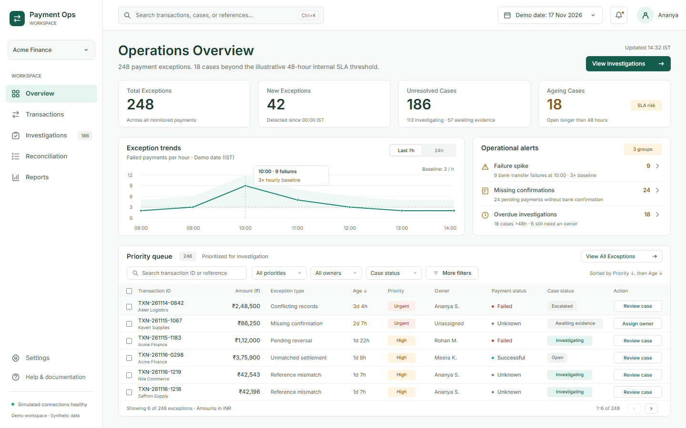
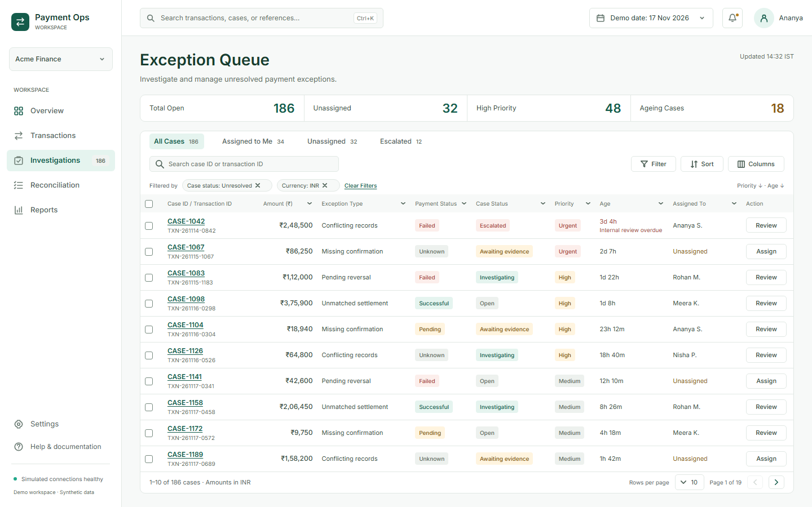
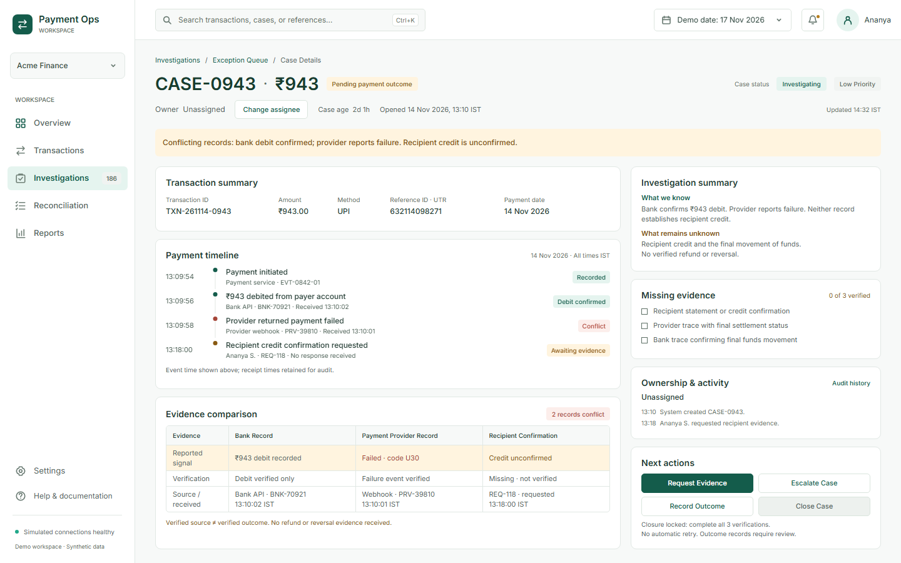
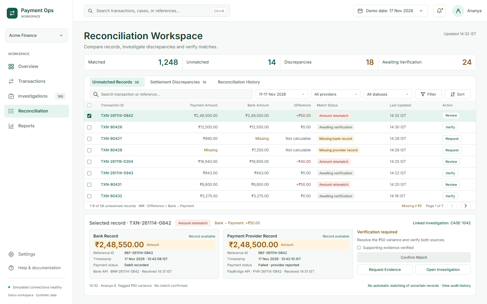

```text
.-----------------------------------------------------------.
|  PAYMENT OPS WORKSPACE                                    |
|  P A Y M E N T   O P E R A T I O N S   /   C O N C E P T  |
'-----------------------------------------------------------'
```

# Payment Ops Workspace

**From fragmented payment signals to evidence-backed resolution.**

[](https://payment-operations-workspace.vercel.app/)


[Ahona’s portfolio](https://www.ahona.works)

## Overview

A fintech operations concept for teams investigating payment exceptions. Bank, provider, and recipient records can describe the same payment differently, leaving analysts to determine which facts are verified and what evidence is still missing. The workspace carries a shared transaction record from detection through triage, investigation, and reconciliation.

## Workflow

```text
[ Monitor ] --> [ Triage ] --> [ Investigate ] --> [ Reconcile ]
     |               |                |                  |
     +---------------+-----------+----+------------------+
                                 |
                  [ Shared synthetic data layer ]
           [ Browser-local edits and audit history ]
```

### 01 / Monitor · Operations Overview

Dataset-derived metrics, hourly failure trends, and grouped alerts that open filtered queue views.



### 02 / Triage · Exception Queue

Search and saved views narrow the queue. Page-scoped selection supports bulk ownership and priority changes with shared updates.



### 03 / Investigate · Investigation Workspace

The **65:35** split keeps the evidence visible while analysts assign work, request records, or review an outcome. The screenshot shows the synthetic ₹943 UPI case.

```text
+--------------------------------------+--------------------+
| 65%  Evidence and analysis           | 35%  Context       |
|                                      |      and actions   |
| Transaction summary                  | Findings           |
| Payment timeline                     | Missing evidence   |
| Source comparison                    | Ownership and log  |
|                                      | Review actions     |
+--------------------------------------+--------------------+
```



### 04 / Reconcile · Reconciliation Workspace

Side-by-side bank and provider records expose amount, reference, and settlement discrepancies. Supported matches require analyst confirmation and produce an audit entry.



## Design decisions

- A shared synthetic dataset carries transaction IDs, amounts, and ownership across screens. Payment, investigation, and reconciliation statuses remain independent.
- Verified evidence, reported information, conflicts, and missing records have distinct labels. Recording an outcome requires three distinct, agreeing evidence references. Matching requires both records, supporting evidence, and confirmation.
- Demo changes and audit history persist in the browser. **Settings → Reset Demo Data** restores the original fixtures after confirmation.

**Design to code** · Figma → MCP → Codex → React. Figma MCP supplied frame measurements, screenshots, and SVGs. Codex translated the reference into shared React components, tokens, and interactive states.

## Run locally

Use Node.js 22.18 or later and npm.

```sh
npm ci
npm run dev
```

Open [localhost:5173](http://127.0.0.1:5173/). Run `npm run typecheck` and `npm run build` for a static build in `dist/`. For browser checks, keep the server running, run `npx playwright install chromium`, then run `npm run test:e2e`.

```text
src/components/    Workspace screens and shared controls
src/data/          Synthetic records, rules, and local persistence
public/figma/      Local design assets
docs/screenshots/  Application screenshots
tests/             Playwright and axe checks
vercel.json        Vite build and direct-route rewrites
```

## Live demo

Pending Vercel deployment. This section will be updated with the public URL after release.

**Scope** · Self-initiated fintech concept with synthetic data, no real financial integrations, and no validated business outcomes. Full QA is pending.

